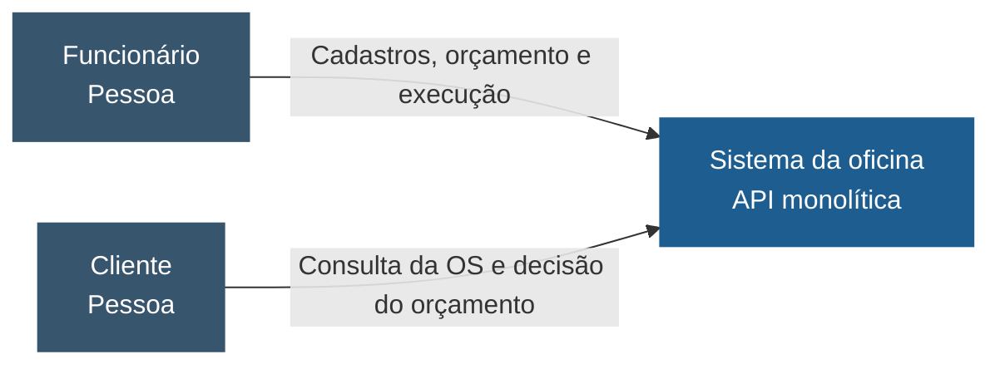
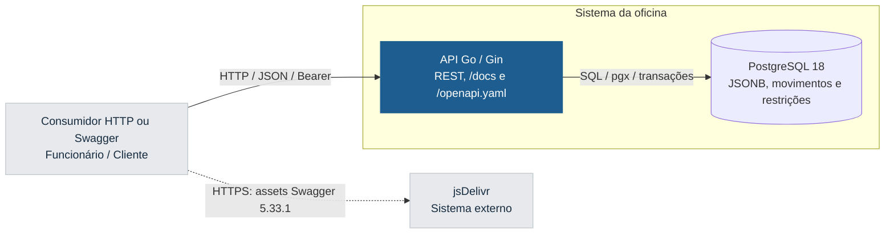
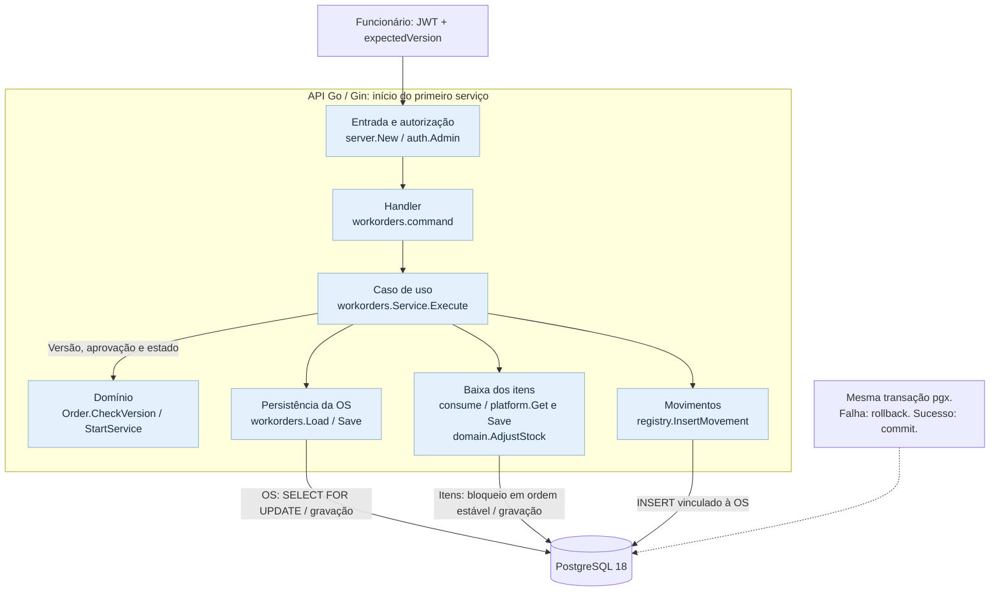

# C4 da oficina

Grupo 1 - Lucas Velôso - RM 377934. Os níveis 1 e 2 descrevem a solução da fase 1. O nível 3 detalha o início do primeiro serviço de uma OS, incluindo a baixa de peças. Todos os componentes pertencem ao mesmo backend Go.

## Nível 1 - Contexto

O funcionário administra a oficina. O cliente consulta a OS autorizada e decide o orçamento pela API.

## Nível 2 - Contêineres

A API Go/Gin serve REST, Swagger e o contrato OpenAPI. PostgreSQL mantém os dados e transações. A CDN jsDelivr fornece somente os assets do Swagger ao navegador; não recebe as chamadas da API. O seed é uma tarefa auxiliar de carga inicial.

## Nível 3 - Componentes do primeiro início

O funcionário chama `POST /api/v1/admin/service-orders/{serviceOrderId}/services/{serviceOrderServiceId}/start` com JWT e `expectedVersion`. A execução usa os seguintes componentes:

| Componente | Correspondência no código | Responsabilidade |
|---|---|---|
| Entrada e autorização | `internal/server/server.go`, `internal/auth/auth.go` | Registrar rotas e validar o JWT administrativo. |
| Handler da OS | `internal/workorders/http.go`, função `command` | Validar IDs e versão recebidos, chamar o caso de uso e responder por HTTP. |
| Caso de uso | `internal/workorders/service.go`, `Service.Execute` | Abrir transação, carregar e bloquear a OS, chamar o domínio, baixar peças quando for o primeiro início, salvar e confirmar. |
| Domínio | `internal/domain/order.go`, `CheckVersion` e `StartService` | Conferir versão, aprovação vigente e estado do serviço; atualizar os estados e horários em memória. |
| Persistência da OS | `internal/workorders/repository.go`, `Load` e `Save` | Ler com `FOR UPDATE` e gravar o agregado da OS. |
| Baixa dos itens | `workorders.consume`, `platform.Get`/`Save`, `domain.AdjustStock` | Bloquear itens em ordem estável, validar saldo e atualizar estoque. |
| Movimentos | `internal/registry/repository.go`, `InsertMovement` | Registrar saída vinculada ao item e à OS. |

O mesmo `pgx.Tx` é passado às operações de persistência. Saldo insuficiente provoca rollback; a alteração de estado em memória também não é salva. A baixa só ocorre no primeiro início. Não há mensageria nesse fluxo.

[PDF com os três níveis](diagramas.pdf).

## Exportações para apresentação

O [PDF dos diagramas](diagramas.pdf) reúne os três níveis do C4. O Event Storming é mantido no [board do Miro](https://miro.com/app/board/uXjVETuWRiI=/), e sua exportação fica em `docs/ddd/event-storming.pdf`.
